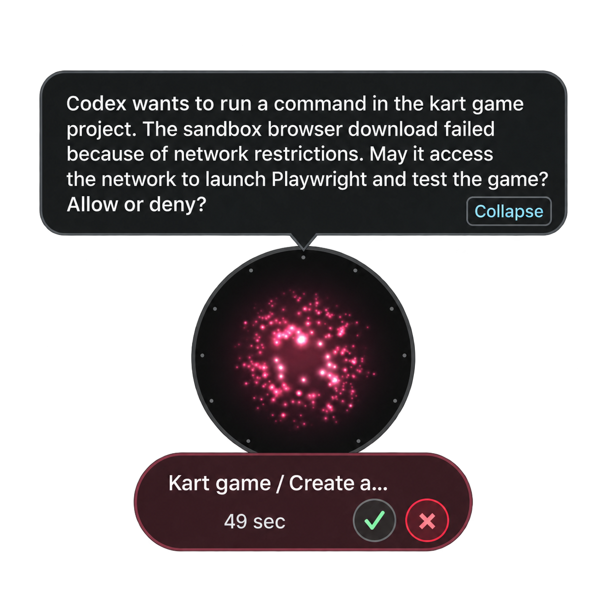

# Tasks

Tasks is where delegated work lives: each Task carries a goal and acceptance criteria, and Nova checks the evidence before it calls one done — never just because a step ran.

## Lifecycle

A Task moves through queued, running, verifying and waiting on its way to completed, or cancelled at any point. Nova drives this loop on its own while it holds control: it dispatches work, evaluates what came back against the acceptance criteria, and either reconciles the goal, corrects the instruction, waits, or completes the Task with the evidence attached. A Task sits in a waiting state when Nova cannot yet confirm what happened — not simply because nothing is happening.

A Task can contain more than one round of execution; each is shown as "Run #1", "Run #2" and so on. Executor work that was never delegated through a Task — nothing owns it — is listed on its own, separately.

Each item on the Tasks page also carries a short next-step summary: needing you, you being in control, nothing to do, or Nova working on it.

## Taking over

| Action | What happens |
|---|---|
| Take over task | You now message the executor directly; Nova pauses automatic correction |
| Take over and reply | Same, and sends your message immediately |
| Return to Nova | Hands control back so Nova resumes deciding and correcting |
| Stop task | Cancels the task. Cancellation is final: the task cannot be continued afterwards, so redoing the work means creating a new task |
| Continue task | Hands a waiting task back to Nova to drive, resetting its correction count; it has no effect on a completed or cancelled task |
| Checked: it ran / Checked: it did not run | Appears only when Nova cannot confirm whether a previous step actually ran, and needs you to say so |
| Mark Todo done | Appears only when the Task is complete but its linked Todo has since changed elsewhere, to resolve the conflict by hand |

Task details shows who is in control right now — you, Nova, or another connected client — along with the acceptance criteria, any pending approvals ("Task approvals", with Allow once / Decline), and a public activity log of updates about the Task shared outside the Workbench.

## Where Nova proposes to run it

Before starting new work, Nova can propose an execution place: a new Workspace, or an existing Workspace with a new or continuing Session (see [Glossary](glossary.md) for what a Workspace and a Session are). Confirm it inline with "Run here", or point it somewhere else with "Run here instead".

## Delegating and following up

From a Todo, "Send to executor" turns it into a Task. "View task and results" opens the Task's detail view; asking about progress drops a prompt into the conversation draft referencing the Task by name, so you can just send it.

## Limits

Nova keeps roughly the last 200 finished Tasks in the Workbench; older ones are pruned automatically as new ones complete. Pruning only removes the Workbench record — it does not touch anything an executor already produced in your Workspace.

[Workbench](workbench.md) · [Sources and connectors](sources-and-connectors.md) · [Glossary](glossary.md) · [Executors](executors/overview.md)

## Scheduled Agent Tasks

Open **Tasks → Scheduled tasks** to create a rule manually, or ask Nova to create one in chat. Both entry points use the same Runtime service. A rule stores the instruction, acceptance criteria, reading scope and timezone. Each occurrence creates its own Agent Task and isolated conversation; it does not inject a fabricated user message into your current chat.

Two suggested tasks are available: **Daily priorities and risk reminders** (09:00 daily), and **Weekly key-project progress** (09:00 Monday). Choose “Set up task” to edit its content and timing; it becomes active only after you save. The weekly report distinguishes dated progress from a current snapshot and reports missing history explicitly.

Choose once, daily or selected weekdays, with an IANA timezone such as `Asia/Shanghai`. The editor previews the first occurrence. Daylight-saving gaps are skipped for recurring rules and rejected for one-time rules; repeated local times run once, at their first occurrence. Moving the system clock backwards does not replay a slot.

The Runtime must be online: a desktop running in the background or an online deployed server is enough; the phone need not stay open. The scheduler checks approximately once per minute, so execution can start after the displayed minute. After downtime, it catches up only the most recent occurrence within two hours, without replaying a backlog. A rule cannot overlap itself; at most two scheduled tasks are prepared at a time, including waiting tasks.

Each run reads fresh authorized App data. It can use selected Todos, Goals, Agent Tasks and authorized memory or knowledge; web search is optional. These runs are read-only. A completed result can open an ordinary discussion, or you can explicitly save it as a Todo or Idea and link a Goal. The Agent does not automatically edit your App records or send messages to others. Revoked or changed evidence is rechecked before further model use and result adoption.

**Pause schedule** stops future occurrences; **Stop active task** cancels the current Task. Editing a rule affects future runs, while an active run keeps its original instruction. If a restart leaves an execution outcome uncertain, Nova waits for reconciliation rather than blindly repeating it. Run history links the rule, occurrence and Task.

The scheduler keeps a durable run ledger beside the personal store and a verified `*.before-schedules.json` backup before introducing hidden schedule conversations. To roll back, stop the Runtime first and preserve the personal, schedules, Tasks and per-run blackboards together. Do not delete the ledger to retry a run: doing so destroys its duplicate-execution protection. Older clients without the scheduling capability keep their existing Task interface.

Verified scheduled reports are delivered as readable messages in the main conversation. Follow up there without opening a separate topic; the attached card leads to run history and schedule controls. Delivery does not switch your selected conversation. “Discuss result” returns to the main conversation, with source permissions checked again before supplying the report to its model.
