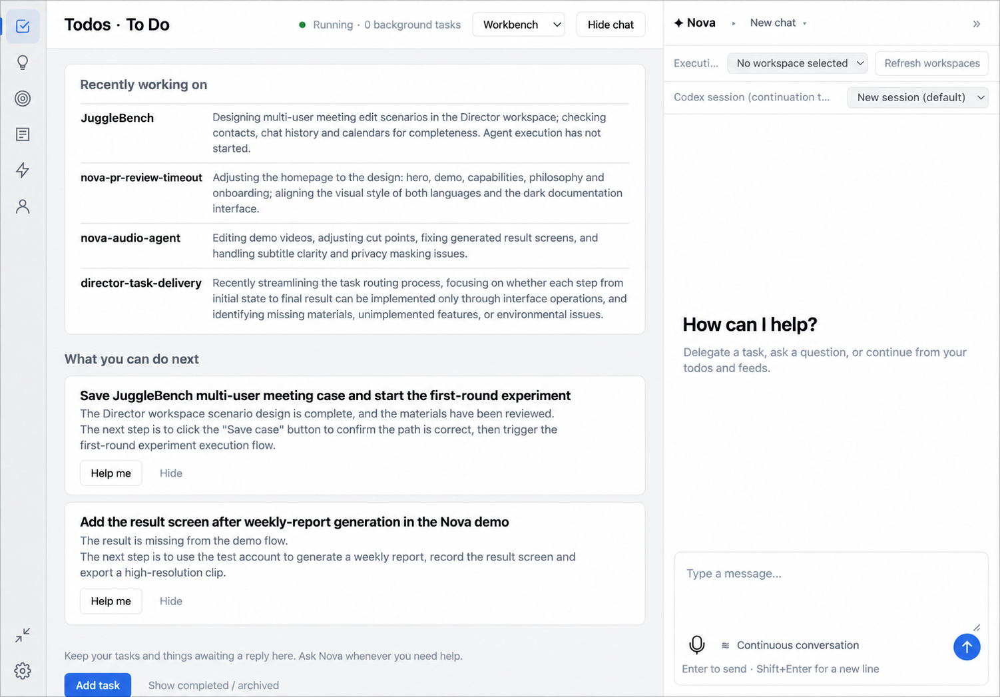
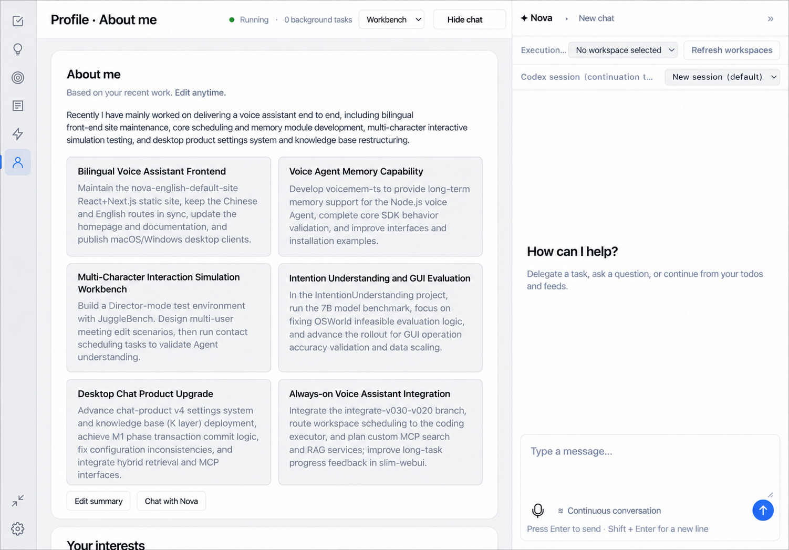

# Workbench

Workbench is Nova's main window. It opens a wide, persistent Nova conversation with a collapsible Timeline sidebar. The rail also opens Todos, Ideas, Goals, Feeds, Tasks and Profile.

## Layout

| Rail item | Holds |
|---|---|
| Nova | Persistent main conversation with proactive reminders and task receipts |
| Timeline | Todo due dates and a separate group for undated items |
| Todos | Things to do, each open, doing, waiting, done or cancelled |
| Ideas | Loose thoughts you may later turn into a Todo or a Goal |
| Goals | Outcomes you're tracking, with success criteria and progress from their linked Todos |
| Feeds | An interest-ranked reading list |
| Tasks | Work you've delegated to an executor — see [Tasks](tasks.md) |
| Profile | A short description of you that Nova can draw on |

The conversation pane docks on the right and can be collapsed without leaving the page you're on. A status line reports whether Nova is connected and how many background tasks are active; while disconnected, anything you were drafting is kept for when it reconnects.

## Switching how Nova appears

Nova can show up three ways: as the Workbench (this window), as a voice orb (a small floating conversation partner), or hidden. Switch between them from the tray icon menu ("Workbench" / "Voice orb" / "Hide"), or from the mode control at the top of any Workbench page. A separate setting picks which of these to open at launch — Orb, Workbench, or whichever you used last — and only takes effect on the next start; running `npm run start:workbench` from source opens the Workbench for that one launch regardless of the saved choice.

## Chat, Plan and Build

Workbench conversations have Chat, Plan and Build modes. New regular conversations start in Chat. These modes do not change the existing permission boundary between the Workbench and the voice orb.

- **Chat** keeps the existing conversation behavior. Nova can answer questions, hand work to an executor when asked, and track existing tasks. You can also ask Nova to switch to Plan. Like the voice orb, Chat cannot read or change local files or run shell commands.
- **Plan** clarifies the goal, scope, constraints and acceptance criteria, asking about ambiguities when needed. It has no local file or shell tools and does not create or dispatch a task before the user chooses. After Nova publishes a plan, you can edit it and choose local Build in the current project or Build through an executor.
- **Build** is text-only and carries out the confirmed plan. On macOS and Windows, Nova can use native file read, write and exact-edit tools, plus shell execution. Platforms without local Build support do not show that entry. The selected project directory is the default working directory, and tools access local resources with the current user's operating-system permissions.

Local Build does not create a task or Todo and does not continue in the background. File reads return at most 2,000 lines or 64 KiB; text writes and exact edits handle at most 1 MiB. Shell commands default to a 60-second timeout (configurable from 1 to 3,600 seconds), and combined stdout/stderr is capped at 64 KiB. When the command leader exits, the host cleans up lingering descendants and preserves its real exit code. Build accepts follow-up messages while running and processes them in order. Each model response may contain up to 64 calls, and each start or Resume may execute up to 128 calls before pausing. Long replies can be expanded to load their full text. Build remains interactive until Nova calls `finish_build`, which permanently locks that conversation. If you switch to the voice orb, hide the Workbench or leave the Build conversation while it is running, the Workbench asks whether to stop first. After stopping, you must explicitly Resume to continue. A restart also does not restore tool-execution authorization automatically.

Local file reads run directly. File writes, edits and shell commands ask for approval each time by default. Change this in Settings → Programming → Local Build tools; the setting affects only local Workbench Build and is separate from executor approval. Continuous voice still uses Chat; starting voice from Plan or Build first returns to Chat.

Plan and Build accept multiple tool calls in one model response through both Chat Completions and Responses. Consecutive independent read-only queries run with up to four concurrent calls. Writes, edits, shell commands, plan publication and other operations run in order after earlier queries finish. Plan permits 24 calls per interaction. Build permits 64 calls per model response and 128 per start or Resume, with separate receipts for approval, Stop and Resume. Build tool calls are grouped into one expandable log per interaction, with each call expandable on its own.

The Build transcript shows every tool call, including file reads, writes, exact edits and shell commands. Each row shows its path or command, status, duration and exit code. Expand it for abbreviated input and output; output updates when the tool returns. The execution log contains the full record. Rows keep their expansion during execution, and the operation history is restored when reopening the conversation or reloading the UI.

Build has no 120-second overall turn deadline. A model connection pauses only after 10 minutes without incoming data, and uses larger streaming limits for long replies and code generation. Model timeouts, connection interruptions and capacity failures explain the reason and offer Resume without replaying completed tools. Each shell command retains its own timeout.

## Todos, Ideas and Goals

These are yours to edit directly, but Nova also proposes changes. When something you say looks like a Todo, Idea, Goal or Profile addition, Nova shows it as a candidate quoting the line it based the suggestion on; you can edit the wording before accepting, or skip it. Some Todos are recorded automatically, and each one can still be undone while it hasn't changed since. Profile suggestions are appended to your existing text rather than replacing it.

Suggestion cards, drawn from the sources you've connected, offer to adopt something as a Goal, hand it to an executor, continue talking about it in chat, or dismiss it. A recap of what your recent project files show you've been working on can appear above the Todos suggestions.

Goal progress counts the Todos linked to it and excludes any that were cancelled; whether a Goal is actually done is always your call, never inferred automatically.

Direct @mentions of you in the Feishu chats you selected can be recorded as Todos once you have given both Feishu consents; see [Sources and connectors](sources-and-connectors.md#feishu).

## Daily briefs

Optional morning and evening briefs summarize your Todos, calendar events and direct Feishu mentions as proactive reminders. Both are off by default. Turn them on in Settings → Connections & permissions → Daily briefs, where you can also set the times (08:30 and 18:30 by default), the repeat days (weekdays by default), the time zone and quiet hours (22:00 to 08:00 by default); no reminders are sent during quiet hours.

## Feeds

Articles ranked to your interests, split into "For you" and "Saved". Until Nova has learned enough about what you read, it falls back to chronological order and asks you to confirm before switching to interest ranking. Each article shows why it was recommended. From an article you can read the original, save it, or convert it into a Todo, Idea or Goal — none of that authorizes Nova to act on it, it only records it. You can also tell Nova to show more or less of a given interest.

## Profile

A short free-text description of you, edited directly or filled in gradually as Nova proposes additions from conversation.

[Tasks](tasks.md) · [Sources and connectors](sources-and-connectors.md) · [Personal memory](personal-memory.md) · [Features](features.md)

## Nova main conversation and Timeline

Workbench opens Nova by default. The main conversation persists and displays proactive reminders and task receipts. Task details, dedicated conversations and voice ownership stay independent. Collapse the Timeline sidebar or open the full Timeline from the rail.

Timeline uses actual Todo due dates and separates undated waiting items. Blue labels indicate time, rose labels indicate importance explicitly marked by you, purple indicates waiting, green indicates progress and amber indicates conditions such as past due. Each color has a text label. Set importance in the Todo editor or full Timeline; it updates the original item. Calendar coverage has not been confirmed, so this view does not represent your complete schedule.

Todo `due` is a nullable date (`YYYY-MM-DD`); creation and update timestamps are not deadlines. Direct-mention Todos from Feishu may carry extracted due dates and remain undated when no date is established. This view organizes dates and does not calculate conflicts between time slots.

Select an item title to reference it in Nova. Draft plan and follow-up actions request a concrete deliverable using that item. References are removable and their versions are checked at send time; drafts and existing execution approvals are preserved. Discuss an article on its own or select a Todo or Goal to explore applications. Interest matching does not automatically create personal-item relationships.
