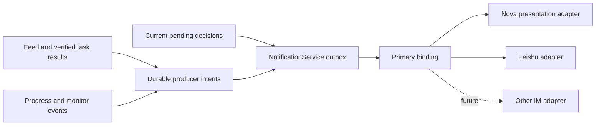

# Proactive notification channels

Nova stores a single primary channel per local user profile. In Settings → IM → Proactive messages, choose Nova or Feishu. Direct user conversations stay in Nova. Task history, approvals and task controls remain available in the Workbench; external notification delivery does not approve or continue a task.

## Configuration and identity

The Feishu app must enable bot capability, grant message sending permissions, and include the recipient in its availability range. Open the bot's private chat before using it. See the [official sending API prerequisites](https://open.feishu.cn/document/uAjLw4CM/ukTMukTMukTM/reference/im-v1/message/create).

Outbound-only authorization verifies the user's identity without requesting chat collection scopes. Collection consent, pause and selected chats are independent of proactive delivery. The sender is the configured app bot and the recipient is the verified account owner. No tenant, organization or recipient configuration is embedded in the repository. Secrets remain in the connector's isolated credential directory.

A binding has a provider, user scope, identity and generation. Changing accounts or applications fences old deliveries and callbacks. Choosing a new primary binding is explicit. Existing additional Feishu reminders are preserved during migration; choosing a primary channel ends that compatibility mode. Existing Feed history is baselined without bulk replay; future snoozes are imported and retain their due time.

## Durability and delivery semantics

`runtime/src/notifications` owns validated contracts, persistent routing, the queue and adapters. A `.notifications.json` file shares the PersonalAgentHost process ownership lock. Network requests run outside the serialized state transaction.

Feed changes and pending notification intents commit together in PersonalStore. The relay writes the notification before clearing its source intent. Completed tasks remain durable in TaskService and are reconciled through TaskLoop on startup and periodic retries; publication does not repeat task execution. Realtime notices retain task goal revisions, evidence references and producer lifecycle guards, checked before every part. Runtime-only guards cannot be recovered after a restart: those queued notices are invalidated rather than delivered from unverifiable state. Feed and verified task results remain recoverable. Pending decisions are reconciled against current approval state; old notices cannot restore approval authority.

Business event, content revision and reminder occurrence provide deduplication. A snooze creates a new occurrence. Prepared multipart messages and per-part receipts are frozen; retries resume only the remaining parts. Feishu uses plain-text cards and chunks long content. Very large results beyond the notification body limit are explicitly marked with a direction to the task details in Nova.

- `accepted` means the platform accepted a message (or Nova durably presented it), not that the recipient read or heard it.
- `retry_wait` means the adapter can prove no acceptance; bounded backoff retains the same idempotency key.
- `unknown` means the request may have arrived. A crash while sending, lost response, or failure saving a receipt never triggers automatic resend. The settings action explicitly acknowledges possible duplication.
- `blocked` preserves the message until the binding or content becomes usable. There is no automatic local fallback.
- Switching routes migrates definitely unsent messages only while their original account identity and generation remain valid. Sending, unknown or partly accepted messages remain bound to their original target.

Ordinary notifications respect quiet hours; existing preemptive monitor alerts retain their explicit urgent classification. External mode suppresses new proactive conversation entries, proactive speech and decision badge contributions while preserving direct replies and passive task/approval views. Audio already played before a switch cannot be recalled.

The outbox is bounded to 16 MiB / 10,000 records. Terminal bodies are pruned after 30 days; compact dedupe records after 90 days. Source removal cancels remaining sends and erases cached content, but does not retract messages already accepted by a remote platform. Capacity errors preserve producer intents; they do not change the task's execution outcome.

## Adding another provider

Implement `NotificationChannelAdapter.inspect`, `prepare` and `send`, register it in composition, and bind a verified recipient. Adapters receive resolved prose and a frozen binding; they do not read arbitrary files or own business logic. Classify unproven transport failures as `unknown`, never retryable. Keep external SDK retries consistent with the supplied idempotency key.

`ChannelInboundEvent` reserves provider event, binding generation, sender, conversation/thread and reply correlation. No inbound chat execution is registered in this version. Existing card feedback is restricted to the actions offered by the original receipt and its exact content revision and reminder occurrence. A stale card cannot modify a newer Feed result; feedback it is not an authorization capability.

## Validation

Deterministic tests cover route migration, legacy compatibility, durable dedupe, unknown outcomes, multipart receipts, source invalidation, identity changes, quiet delivery boundaries and direct-reply preservation. Feishu CLI tests use isolated simulated responses and do not send real messages. Real account permissions, official-client receipt and device audio acceptance require a separate live check.

## Producer ownership

| Source | Notification owner | External-mode behavior |
| --- | --- | --- |
| Daily briefs and proactive Feed suggestions | PersonalAgentHost durable intent | IM delivery; no new proactive chat or speech |
| Verified durable task results | TaskLoop → Feed intent | Full verified prose, with explicit size-limit notice |
| Unbound executor results and deadlines | ProviderProjection | Structured result text, excluding internal work instructions |
| Progress and monitor alerts | ProviderProjection | Current lifecycle/evidence checked before each part |
| Approval, confirmation and waiting-task notices | PersonalAgentHost reconciliation | Reminder to act in Nova; no remote execution authority |
| User-initiated replies and synchronous tools | Existing conversation path | Reply stays with the user's active Nova conversation |

A Feed item's speech selection refers to an already admitted notification and does not publish a second message. Locally generated autonomous task prose retains its original conversation entry; verified-result projection avoids repeating that prose. External delivery keeps generated evidence distinct from spoken or read acceptance.

### Implementation verification (2026-10-12)

- Runtime build and lint pass. Full runtime suite: 3,415 pass, 8 skipped, 2 failures in `memory-substrate.test.ts`; both failures reproduce on untouched base `89804c57` with expired fixed-date fixtures.
- All 25 notification-specific tests pass, including the final lifecycle and restart cases added after the full run.
- Full desktop suite: 1,248 pass, 3 skipped; source startup smoke was skipped by its harness. CLI and server CLI: 34 pass.
- A fresh whole-feature review found eight consequential issues; all were fixed with regression coverage. No minor findings were deferred.
- Flutter SDK is unavailable in this environment, so the small unread-badge change has not been analyzed with Flutter. Real Feishu delivery and physical-device audio remain untested.
